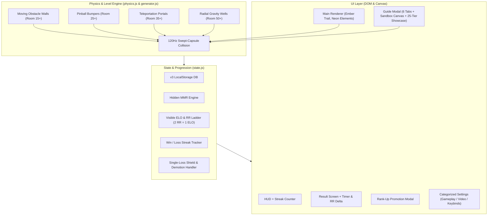

# Implementation Plan: Bankshot v3 — Hard Valorant Ranked Ladder, Gameplay Expansion, Overhauled Guide & Production Settings

## Goal Description
Transform Bankshot into a comprehensive competitive puzzle experience:
1. **Hard Valorant Ranked Progression**: True competitive skill climb with **hidden MMR**, convergence scaling, dynamic performance scoring, streak multipliers, and single-loss demotion shields.
2. **Database Version Reset (`bankshot.db.v3`)**: Clean reset to **Iron I (0 ELO, 0 RR)** while preserving room records and user settings.
3. **Four New Interactive Physics Puzzle Mechanics**: Moving walls, pinball bumpers, portals, and gravity wells with clean neon vector texturing.
4. **Overhauled 'How to Play' Screen**: 6 streamlined tabs featuring an **interactive playable mini-canvas sandbox** and an **interactive 25-tier Valorant ranked ladder breakdown**.
5. **Production-Grade Settings Screen**: Categorized sections for **Gameplay & Controls**, **Video & Accessibility**, and a styled **Keybinds Reference** with responsive layouts across mobile (360px) to 4K displays.
6. **Arcade Juice & Feedback**: Puck ember fire trail on $3+\text{W}$ win streaks, rank promotion fanfare celebration, perfect hole-in-one visual bursts, HUD combo streak counters, and room clear timers.

---

## User Review Required

> [!IMPORTANT]
> **Database Version Bump & Reset (`bankshot.db.v3`)**:
> On next launch, existing player saves will automatically migrate to `bankshot.db.v3`. All ranks, ELO, RR, and match history will be reset to **Iron I (0 ELO, 0 RR)** to begin the hard climb from scratch. Existing unlocked rooms (`levelRecords`), player settings (`aimPreview`, `reducedMotion`), and `seenGuide` flags will be preserved.

> [!WARNING]
> **High-Skill Competitive Grind**:
> Climbing now demands a consistent **>55% win rate** and clean shot execution. Over-par shots suffer diminishing returns, while budget exhaustion applies cascading loss-streak penalties. Hidden MMR converges with visible ELO to prevent rank inflation.

---

## Architecture Overview



---

## Proposed Changes

### Component 1: State Machine, Hidden MMR & v3 Reset (`src/state.js`)

#### [MODIFY] `src/state.js`

1. **v3 Database Migration & Hard Reset**:
   - Bump storage key to `'bankshot.db.v3'`.
   - On initialization: if `v3` is absent, migrate from `v2`:
     - Retain `userSeed`, `levelRecords`, `roomFailures`, `seenGuide`, and `settings`.
     - Reset `elo = 0`, `mmr = 0`, `winStreak = 0`, `lossStreak = 0`.
     - Reset `rank = { tierIndex: 0, elo: 0, rr: 0, peakElo: 0, peakIndex: 0, matchHistory: [] }`.

2. **Hidden MMR & Convergence Formula**:
   - Track `data.mmr` alongside `data.elo`.
   - Performance evaluation per room:
     - Shot Efficiency: $R = \text{shots} / \text{par}$.
     - Speed Factor: bonus for clears under 6s and 12s.
     - First-Attempt Clean Clear: $+2$ bonus if no session restarts/retries.
   - **Convergence Multiplier**:
     $$\text{convergence} = \text{clamp}\left(1 + \frac{\text{MMR} - \text{ELO}}{100}, 0.6, 1.4\right)$$
   - When $\text{MMR} > \text{ELO}$, wins give bonus RR to accelerate catch-up; when $\text{MMR} < \text{ELO}$, gains are suppressed and losses are penalized more heavily.

3. **Multi-Factor Dynamic ELO Calculation**:
   - **Base ELO on Win**:
     - Under Par (S-rank): $+9\text{ ELO}$ ($+18\text{ RR}$)
     - On Par (A-rank): $+6\text{ ELO}$ ($+12\text{ RR}$)
     - Par $+1$ (B-rank): $+4\text{ ELO}$ ($+8\text{ RR}$)
     - Par $+2$ (C-rank): $+2\text{ ELO}$ ($+4\text{ RR}$)
     - Over Par $+3$ or worse: $+1\text{ ELO}$ ($+2\text{ RR}$)
   - **Speed Bonus**: $< 6\text{s} \implies +2\text{ ELO}$, $< 12\text{s} \implies +1\text{ ELO}$.
   - **First-Attempt Bonus**: $+2\text{ ELO}$ ($+4\text{ RR}$).
   - **Room Difficulty Scaling**:
     $$\text{diffScale} = \text{clamp}\left(0.85 + \frac{\text{room}}{100} \times 0.45, 0.85, 1.30\right)$$
   - **Streak Multipliers**:
     - Win Streak: $1\text{W} \implies 1.0\times$, $2\text{W} \implies 1.1\times$, $3\text{W} \implies 1.25\times$, $4\text{W}+ \implies 1.4\times$.
     - Loss Streak: $1\text{L} \implies 1.0\times$, $2\text{L} \implies 1.15\times$, $3\text{L}+ \implies 1.35\times$.
   - **Base Loss Penalty**:
     - Budget exhaustion: $-8\text{ ELO}$ ($-16\text{ RR}$) $\times \text{lossStreakMultiplier} \times \text{convergence}$.

4. **Valorant Demotion Shield**:
   - If player's division RR $> 0$, first loss drops to $0\text{ RR}$ (floor protected).
   - If player loses at $0\text{ RR}$, demote to previous tier at $70\text{ RR}$ ($-15\text{ ELO}$ below tier boundary).

5. **Interface Additions**:
   - `store.recordSuccess(level, shots, triesUsed, maxTries, roomTime, isFirstAttempt)`.
   - `store.getRankInfo()` returns `winStreak`, `lossStreak`, `mmr`, `justPromoted`, `promotedTier`.

---

### Component 2: Physics Engine for New Elements (`src/physics.js`)

#### [MODIFY] `src/physics.js`

1. **Moving Walls**:
   - Stored in `world.movingWalls`:
     `{ a: [x1, y1], b: [x2, y2], delta: [dx, dy], freq: number, phase: number, active: true }`.
   - In `stepWorld(world, dt)`:
     - Endpoints oscillate: $A(t) = A_0 + \sin(\omega t + \phi) \cdot \Delta$.
     - Recompile dynamic collision vectors $(dx, dy, nx, ny)$.
     - Collision sweeps puck against current dynamic segment.

2. **Pinball Bumpers**:
   - Stored in `world.bumpers`:
     `{ x: number, y: number, radius: number, restitution: 1.25, hitAt: number }`.
   - Continuous circle-to-circle sweep collision:
     - Sweep circle of radius $R_{\text{puck}} + R_{\text{bumper}}$ around $(x, y)$.
     - On collision: calculate radial normal $\hat{n}$, apply $1.25\times$ velocity reflection boost up to $P.maxSpeed$, and trigger bumper flash.

3. **Teleportation Portals**:
   - Stored in `world.portals`:
     Pairs of portals $\{ \text{id}, A: \{ x, y, nx, ny, radius \}, B: \{ x, y, nx, ny, radius \}, cooldown: number \}$.
   - When puck crosses portal $A$'s circle and velocity is entering the portal face:
     - Instantly translate puck to portal $B$'s forward anchor point.
     - Rotate velocity vector by angle delta between exit and entrance normals.
     - Set short cooldown ($0.15\text{s}$) to avoid recursive re-entry.
   - Predictive aim trajectory (`getAimTrajectory`):
     - Traces ray through portal $A$ and emerges from portal $B$ seamlessly.

4. **Gravity Wells**:
   - Stored in `world.gravityWells`:
     `{ x: number, y: number, radius: 140, strength: 2200 }`.
   - In `stepWorld(world, dt)` during gliding:
     - For each well, calculate distance $d = \text{hypot}(x_G - x, y_G - y)$.
     - If $d < \text{radius}$ and $d > R_{\text{puck}}$:
       $$a = \frac{\text{strength} \times (1 - d / \text{radius})}{d}$$
       $$v_x += a \times (x_G - x) \times dt, \quad v_y += a \times (y_G - y) \times dt$$
     - Smoothly bends the puck path in a cosmic orbital arc.

---

### Component 3: Procedural Level Generation (`src/generator.js`)

#### [MODIFY] `src/generator.js`

1. **Element Progression Thresholds**:
   - **Solid Walls**: Rooms 1+
   - **Rubber Walls**: Rooms 10+
   - **Moving Walls**: Rooms 15+
   - **Glass Walls**: Rooms 20+
   - **Pinball Bumpers**: Rooms 25+
   - **Hazard Zones**: Rooms 30+
   - **Portals**: Rooms 35+
   - **Gravity Wells**: Rooms 50+

2. **Safe Placement & Solution Verification**:
   - Synthesize elements into `room.movingWalls`, `room.bumpers`, `room.portals`, and `room.gravityWells`.
   - The generator ensures elements do not overlap puck spawn or goal.
   - `simulateSolution` incorporates the new physical elements; rooms must be physically won under par to pass verification.

---

### Component 4: Vector Canvas Renderer & Visual Juice (`src/render.js` & `src/config.js`)

#### [MODIFY] `src/config.js`
- Palette tokens:
  - `portalCyan: '#00E5FF'`
  - `bumperOrange: '#FF9100'`
  - `gravityPurple: '#D500F9'`
  - `movingWhite: '#FFFFFF'`
  - `fireGold: '#FFD700'`
  - `fireAmber: '#FF6D00'`

#### [MODIFY] `src/render.js`
1. **Rendering New Elements**:
   - **Moving Walls**: Clean pulsating white line with dashed track line indicating range of motion.
   - **Bumpers**: Concentric neon amber vector circles with radial tick marks, pulsing scale on impact.
   - **Portals**: Glowing cyan dual-ring vector ellipses with swirling dotted core particles.
   - **Gravity Wells**: Concentric faint purple gravitational field rings with inward-pointing field markers.
2. **Win Streak Ember Fire Trail**:
   - When player is on a $3+\text{W}$ win streak, the puck leaves glowing flame/ember particles ($x, y, r, opacity$) that fade out behind it.
3. **Perfect Hole-in-One Burst**:
   - If a room is cleared in exactly $1$ shot, spawn a golden 12-point starburst and expanding ring at the goal.

---

### Component 5: Overhauled 'How to Play' Screen & Interactive Sandbox (`src/ui.js` & `src/styles/ui.css`)

#### [MODIFY] `src/ui.js`

1. **6 Streamlined Tabs**:
   - `Tab 0: BASICS & CONTROLS`: Mouse/touch pull-back slingshot, keyboard arrows + Space, Shift for fine aim.
   - `Tab 1: PHYSICS & SURFACES`: Angle in = angle out, solid 80%, rubber 98%, glass threshold breaking, hazard resets.
   - `Tab 2: NEW ELEMENTS`: Visual guide to Moving Walls (Room 15+), Pinball Bumpers (Room 25+), Portals (Room 35+), and Gravity Wells (Room 50+).
   - `Tab 3: RANKED LADDER & MMR`: Interactive showcase of all 25 Valorant tier emblems (Iron I to Radiant), explanation of $2\text{ RR} = 1\text{ ELO}$, hidden MMR convergence, streak multipliers, and single-loss demotion shields.
   - `Tab 4: PRACTICE SANDBOX`: Embedded live mini-canvas where players can freely pull, aim, shoot, bounce off walls, and hit a goal to calibrate their touch before entering a match!
   - `Tab 5: PRO TIPS`: Advanced tactics (corner banking, glass clearing, momentum control, soft positioning).

2. **Sandbox Mini-Canvas Implementation**:
   - Uses a lightweight sandboxed `createWorld` with a puck, walls, a rubber bumper, a portal, and a goal.
   - Fully interactive with pointer/mouse events.

---

### Component 6: Categorized Production Settings Screen (`src/ui.js` & `src/styles/ui.css`)

#### [MODIFY] `src/ui.js` & `src/styles/ui.css`

1. **Categorized Settings Screen Structure**:
   - **GAMEPLAY & CONTROLS**:
     - `AIM PREVIEW`: Toggle ON / OFF with sleek tactile pill switch.
     - `TOUCH DRAG SENSITIVITY`: Calibrated pull responsiveness.
   - **VIDEO & ACCESSIBILITY**:
     - `REDUCED MOTION`: Toggle OFF / ON / SYSTEM.
     - `DISPLAY DENSITY`: High-DPI crisp mode toggle.
   - **KEYBINDS REFERENCE**:
     - Styled tabular shortcut cards with `<kbd>` tags (Aim: `ARROWS`, Fine Aim: `SHIFT`, Charge: `SPACE`, Restart: `R`, Help: `H`, Pause: `ESC`).
   - Clean, centered container (`max-width: 480px`) with guaranteed no-overflow on mobile viewports (360px) up to 4K.

2. **HUD & Result Screen Juice**:
   - **HUD Streak Box**: Shows `🔥 3W` or `2L` in `<dl class="hud-metrics">`.
   - **Result Screen**: Shows `TIME: 5.34s` and `+18 RR (+9 ELO)`.
   - **Rank-Up Celebration Modal**: Dramatic full-screen promotion fanfare when crossing into a new tier.

---

## Verification Plan

### Automated Tests
1. **Node Unit & System Tests**:
   - Physics suite:
     ```powershell
     & "C:\Users\Outcast\AppData\Roaming\Antigravity\bin\agy-node.cmd" --test tests/physics.test.mjs
     ```
     Verifies moving walls, bumper reflections, portal teleportation, and gravity well forces.
   - Generator suite:
     ```powershell
     & "C:\Users\Outcast\AppData\Roaming\Antigravity\bin\agy-node.cmd" --test tests/generator.test.mjs
     ```
     Verifies room synthesis with new mechanics and solution verification.
   - State suite:
     ```powershell
     & "C:\Users\Outcast\AppData\Roaming\Antigravity\bin\agy-node.cmd" --test tests/state.test.mjs
     ```
     Verifies v3 migration, hard climb ELO, hidden MMR convergence, streak multipliers, and demotion shield.
   - Complete unit suite:
     ```powershell
     & "C:\Users\Outcast\AppData\Roaming\Antigravity\bin\agy-node.cmd" --test tests/physics.test.mjs tests/generator.test.mjs tests/state.test.mjs tests/aim.test.mjs tests/input.test.mjs
     ```

2. **Browser Acceptance Tests**:
   - Run Playwright E2E suite:
     ```powershell
     & "C:\Users\Outcast\AppData\Roaming\Antigravity\bin\agy-node.cmd" tests/browser.test.mjs
     ```
     Verifies 14 cleared rooms, sandbox canvas interactivity, settings navigation, and zero console errors.

3. **Production Build**:
   - Run Vite singlefile build:
     ```powershell
     & "C:\Users\Outcast\AppData\Roaming\Antigravity\bin\agy-node.cmd" "node_modules\vite\bin\vite.js" build
     ```

### Manual Verification
- Launch local server (`http://localhost:8000`).
- Verify save reset to Iron I (0 ELO, 0 RR) with preserved settings.
- Open **Settings**: verify categorized sections (Gameplay, Video, Keybinds) and responsive alignment.
- Open **How to Play**:
  - Test all 6 tabs.
  - Test Tab 3: verify 25 Valorant tier emblems, MMR explanation, and demotion shield details.
  - Test Tab 4 (Practice Sandbox): pull back and shoot the puck in the live sandbox inside the guide!
- Play rooms 1-5: verify HUD combo streak (`1W`, `2W`, `🔥 3W`).
- Verify ember fire trail appears on puck after 3 consecutive wins.
- Test Room 15+ (moving walls), Room 25+ (bumpers), Room 35+ (portals), Room 50+ (gravity wells).
- Verify rank promotion celebration triggers upon reaching 100 RR / 50 ELO (Iron II).
