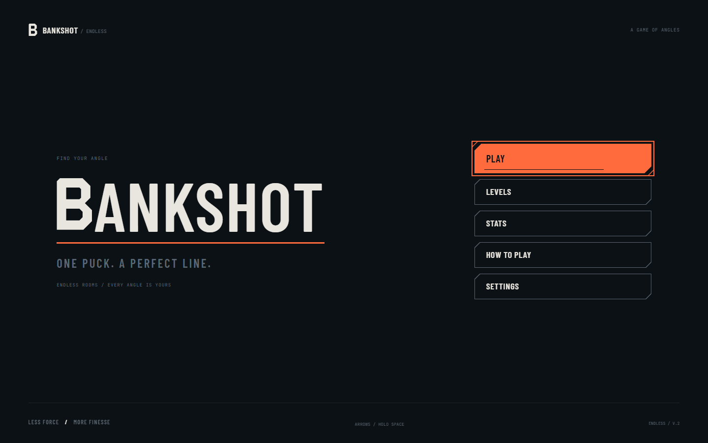
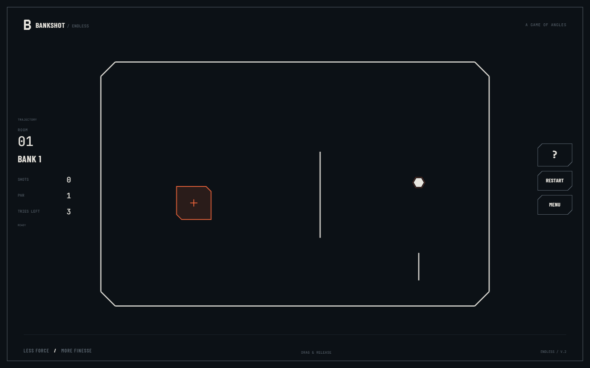
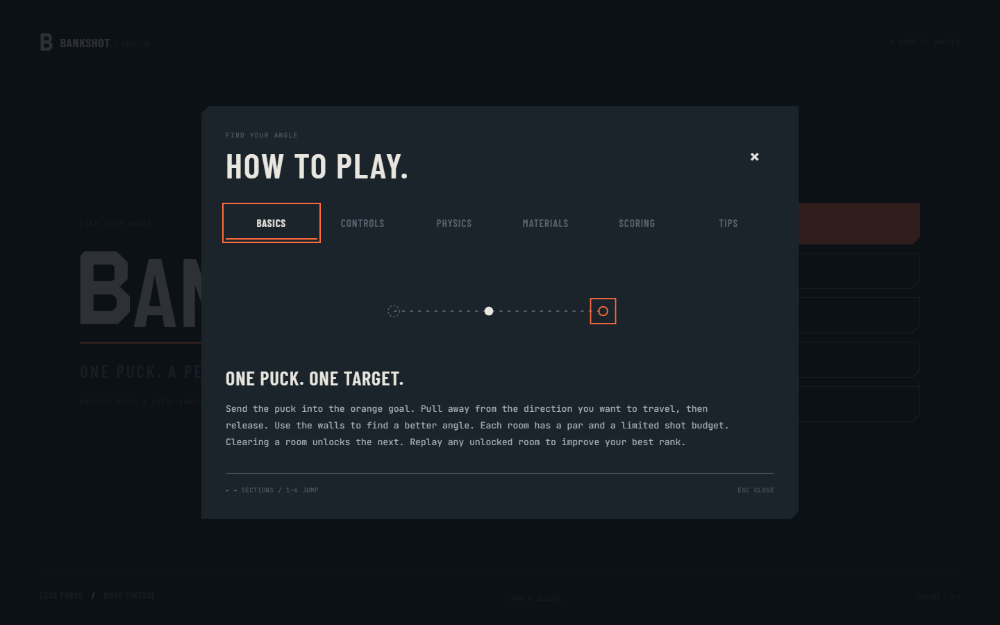
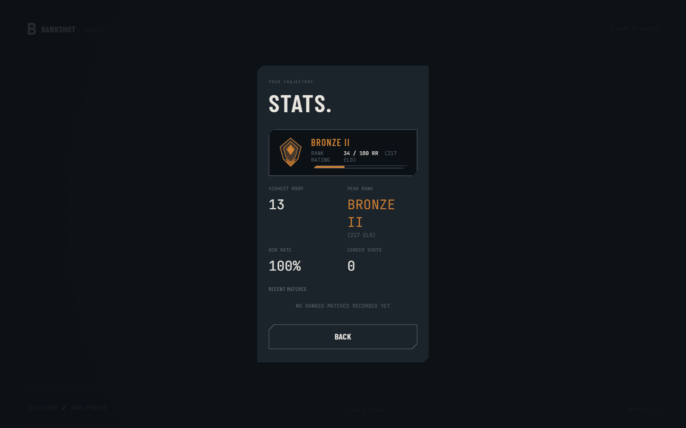
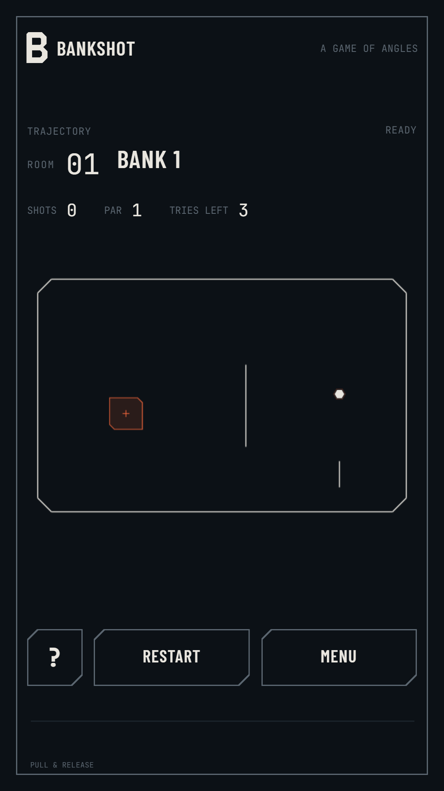
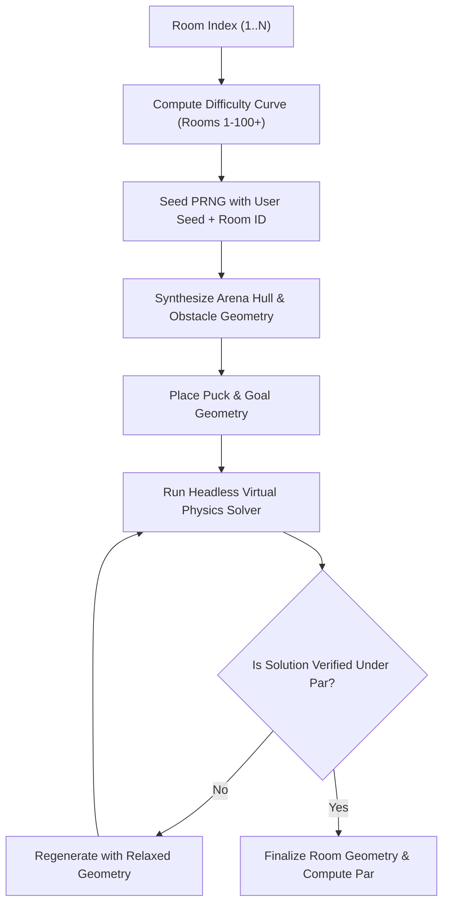

> **v3 update:** See [current ranked rules, migration, mechanics, and settings](docs/bankshot-v3.md). The v3 implementation supersedes older rating examples below.

<div align="center">

# 🎱 BANKSHOT

**A deterministic 2D precision bank-shot billiards physics puzzle game with endless procedural levels, 8-ball pool predictive reflection trajectories, and a Valorant-style competitive ranked progression system.**

[](https://developer.mozilla.org/en-US/docs/Web/JavaScript)
[](https://developer.mozilla.org/en-US/docs/Web/API/Canvas_API)
[](#-mathematics--physics-engine)
[](#-testing--quality-assurance)
[](#-browser-acceptance-suite)
[](#-zero-runtime-dependencies)
[](LICENSE)

<br/>

> *"ONE PUCK. A PERFECT LINE. ENDLESS ROOMS. EVERY ANGLE IS YOURS."*

<br/>



</div>

---

## 📑 Table of Contents

- [Overview](#-overview)
- [Visual Showcase](#-visual-showcase)
- [Core Gameplay & Features](#-core-gameplay--features)
- [Valorant-Style Ranked System (ELO & RR)](#-valorant-style-ranked-system-elo--rr)
- [Mathematics & Physics Engine](#-mathematics--physics-engine)
- [Procedural Level Generation](#-procedural-level-generation)
- [Adaptive Budget & Pity System](#-adaptive-budget--pity-system)
- [Controls & Input Modes](#-controls--input-modes)
- [Quick Start (Zero Build Required)](#-quick-start-zero-build-required)
- [Testing & Quality Assurance](#-testing--quality-assurance)
- [Codebase Architecture](#-codebase-architecture)
- [Production Build](#-production-build)
- [License](#-license)

---

## 🌟 Overview

**Bankshot** is an arcade precision puzzle game designed around geometric bank shots, specular wall bounces, and spatial calculation. Built entirely with vanilla web technologies, the game pairs high-framerate 2D vector canvas rendering with a continuous swept-capsule collision physics engine and an endless procedural room generator that physically verifies every solution before presenting it to the player.

Players compete through a tiered ranked ladder inspired by **Valorant**, earning **Rank Rating (RR)** and persistent **ELO** rating (`2 RR = 1 ELO`) across 25 distinct competitive tiers from **Iron I** to **Radiant**.

### Key Highlights
* 🎯 **8-Ball Pool Predictive Trajectory**: Dotted projection line reveals the exact launch path and specular reflection normal before you release.
* ⚡ **120 Hz Continuous Collision Physics**: Sub-step swept-circle continuous collision detection ensures no tunneling through thin walls even at 3,200 px/s.
* 🌌 **Infinite Procedural Rooms**: Seed-driven level generation with a physical validation solver that guarantees 100% solvable puzzle geometry.
* 🏆 **Competitive Ranked Ladder**: Full 25-tier progression system (Iron, Bronze, Silver, Gold, Platinum, Diamond, Ascendant, Immortal, Radiant) with demotion shields and match history.
* 🧠 **Adaptive Difficulty**: Rolling 10-attempt performance ratios adjust shot budgets dynamically, with mercy pity tries for struggling rooms.
* 📱 **Universal Cross-Platform Controls**: Seamless support for mouse slingshots, fine touch drag-and-release, and precision keyboard aiming (`Shift` for fine angular adjustments).
* 🛡️ **Zero Runtime Dependencies**: Pure ES2022 modules, single-file canvas rendering, local storage persistence, and full offline functionality.

---

## 📸 Visual Showcase

<div align="center">

| In-Game Precision Aiming & HUD | Interactive Vector Guide |
| :---: | :---: |
|  |  |
| *8-ball pool specular aim trajectory with live try budget and par* | *Interactive multi-tab modal with kinetic vector line-art* |

| Competitive Ranked Career Profile | Responsive Mobile & Touch Play |
| :---: | :---: |
|  |  |
| *Valorant rank emblems, division RR gauge, ELO tracking & match history* | *Responsive touch slingshot interface optimized for mobile* |

</div>

---

## 🎮 Core Gameplay & Features

### 1. 8-Ball Pool Style Predictive Trajectory
Pulling back on the puck casts a ray along your launch vector, calculating:
* Direct distance and power indicator with calibrated dead-zones.
* The exact point of first impact with any wall geometry.
* The specular reflection angle calculated via $\vec{v}' = \vec{v} - 2(\vec{v} \cdot \hat{n})\hat{n}$.
* A trailing dotted trajectory that automatically truncates on goal capture or material boundaries.

### 2. Reactive Surface Materials
Different room walls feature distinct physical and behavioral properties:
| Material | Restitution | Behavior | Visual Indicator |
| :--- | :---: | :--- | :--- |
| **Solid Wall** | `0.80` (80%) | Standard firm reflection; foundational puzzle surface. | High-contrast bone stroke (`#E9E6DF`) |
| **Rubber Wall** | `0.98` (98%) | Hyper-elastic rebound; preserves almost all kinetic energy. | Vibrant cyan glow (`#4DD0E1`) |
| **Glass Wall** | `0.70` (70%) | Brittle; shatters on high-speed impact (>650 px/s), opening new routes. | Frosted line-art (`#80CBC4`) |
| **Hazard Barrier**| `0.00` (0%) | Instantly consumes the shot and resets puck to origin. | Hazard red / warning amber (`#FF5252`) |

---

## 🏆 Valorant-Style Ranked System (ELO & RR)

Bankshot features a competitive progression system modeled after **Valorant's competitive ranking architecture**, connecting room performance directly to a global player **ELO** and division **Rank Rating (RR)**.

```
┌──────────────────────────────────────────────────────────────────────────────────┐
│  IRON      BRONZE     SILVER     GOLD       PLATINUM   DIAMOND    ASCENDANT  ... │
│  [I-II-III][I-II-III] [I-II-III] [I-II-III] [I-II-III] [I-II-III] [I-II-III] ... │
└──────────────────────────────────────────────────────────────────────────────────┘
```

### The `2 RR = 1 ELO` Equivalence
* **Equivalence**: **`2 RR = 1 ELO`** ($\implies 1\text{ ELO} = 2\text{ RR}$).
* **Division Span**: Every sub-tier spans exactly **`50 ELO`** ($100\text{ RR}$).
* **Tier Index**: $\text{Tier} = \min\left(24, \lfloor \text{ELO} / 50 \rfloor\right)$.
* **Division RR**: $\text{RR} = (\text{ELO} \pmod{50}) \times 2$.
* **Radiant Tier**: Achieved at $1,200+\text{ ELO}$, where RR continues uncapped.

### Ranked Scoring Table
| Outcome | Performance Threshold | ELO Delta | RR Delta |
| :--- | :--- | :---: | :---: |
| **Flawless Win** | Cleared under par (Rank **S**) | `+15 ELO` | `+30 RR` |
| **On-Par Win** | Cleared exactly on par (Rank **A**) | `+11 ELO` | `+22 RR` |
| **Over-Par Win** | Cleared over par (Rank **B / C**) | `+8 ELO` | `+16 RR` |
| **First-Clear Bonus** | First time completing a new room | `+5 ELO` | `+10 RR` |
| **Room Failure** | Shot budget exhausted | `-7 ELO` | `-14 RR` |

### Demotion Shield & Fair Retry Rules
1. **Division Demotion Shield**: If a player's division RR is above `0`, a failure can only reduce their rating down to the division floor (`0 RR`). It will not demote them across tiers on that initial loss.
2. **Grace Landing Buffer**: A demotion from an already-at-zero tier drops the player to `76 RR` in the prior division rather than resetting them to bottom.
3. **Practice & Mid-Attempt Retries**: Pressing `R` or selecting "Restart" while remaining within your allotted budget **never penalizes rank rating**.

---

## 🔬 Mathematics & Physics Engine

The physics simulation runs on a decoupled **deterministic fixed-step accumulator** at $120\text{ Hz}$ ($\Delta t = 8.33\text{ ms}$), with sub-step linear interpolation for display smoothing:

$$\text{accumulator} = \min(\text{accumulator} + \Delta t_{\text{frame}}, \text{maxFrame})$$

### Swept Capsule Continuous Collision Detection
To prevent bullet tunneling through ultra-thin walls, movement vectors are swept as continuous capsules against line segments:

Given puck position $\vec{P}$, velocity $\vec{V}$, radius $r$, and a wall segment from $A$ to $B$:
1. Parameterize the closest point on segment $\overline{AB}$ to puck trajectory $\vec{P}(t) = \vec{P}_0 + t\vec{V}$.
2. Solve the quadratic intersection for distance $d(t) \le r$.
3. Compute radial vertex collision normal if hitting endpoints, or perpendicular face normal $\hat{n}$:
$$\hat{n} = \frac{(B_y - A_y, -(B_x - A_x))}{\|\vec{B} - \vec{A}\|}$$
4. Reflect velocity vector according to material coefficient of restitution $e$:
$$\vec{V}' = \vec{V} - (1 + e)(\vec{V} \cdot \hat{n})\hat{n}$$

### Exponential Kinetic Damping
Free puck gliding applies velocity damping per step:
$$\vec{V}_{t+1} = \vec{V}_t \cdot \left(1 - \text{damping} \cdot \Delta t\right)$$
Motion ceases completely when $\|\vec{V}\| < v_{\text{stop}}$ ($1.5\text{ px/s}$).

---

## 🎲 Procedural Level Generation

Every room in Bankshot is generated on-demand using a deterministic seeded pseudo-random number generator:



1. **Scalable Difficulty**: Obstacle density, wall counts, rubber segments, glass barriers, and hazards scale progressively across 5 distinct thematic chapters.
2. **Generate-and-Verify Solver**: A virtual physics simulation fires candidate trajectories across a 48-ray radial pattern, tracing reflections and validating that a clean geometric solution exists before the room is presented.

---

## 📈 Adaptive Budget & Pity System

Rather than enforcing rigid attempt limits, Bankshot's state machine monitors the player's rolling completion ratio:

$$\text{Ratio} = \frac{1}{K}\sum_{i=1}^{K} \frac{\text{shots}_i}{\text{par}_i} \quad (K \le 10)$$

* **Mastery Bracket** ($\text{Ratio} \le 1.05$): Expert players are granted strict, tight budgets ($\text{par} + 1$).
* **Standard Bracket** ($1.05 < \text{Ratio} \le 1.5$): Balanced puzzle exploration ($\text{par} + 2$).
* **Lenient Bracket** ($\text{Ratio} > 1.5$): Extended exploration ($\min(5, \text{par} + 3)$).
* **Pity Assistance**: Every 3 consecutive failures on the same room increment the budget by $+1$ try, resetting immediately upon completion.

---

## ⌨️ Controls & Input Modes

| Action | Mouse | Touch | Keyboard |
| :--- | :--- | :--- | :--- |
| **Aim Direction** | Drag puck backward | Pull puck backward | `Arrow Left` / `Arrow Right` |
| **Fine Angle Aim** | Minor pointer delta | Fine drag | Hold `Shift` + `Arrows` |
| **Charge Power** | Pull distance | Pull distance | Hold `Space` |
| **Shoot Puck** | Release mouse | Release finger | Release `Space` |
| **Cancel Shot** | Right-click / Escape | Touch secondary finger | `Escape` |
| **Quick Restart** | Click HUD `RESTART` | Tap HUD `RESTART` | `R` |
| **How to Play** | Click HUD `?` | Tap HUD `?` | `H` |
| **Pause / Menu** | Click HUD `MENU` | Tap HUD `MENU` | `Escape` |

---

## 🚀 Quick Start (Zero Build Required)

Bankshot is built as a **zero-dependency vanilla web application**. You can run it instantly using any static web server:

### Option 1: Python HTTP Server
```bash
# Clone the repository
git clone https://github.com/xgoat-tbh/bankshot.git
cd bankshot

# Start server
python3 -m http.server 8000
```
Then navigate to `http://localhost:8000` in your browser.

### Option 2: Node.js (npx serve)
```bash
npx serve .
```

### Option 3: Modern Vite Development
```bash
npm install
npm run dev
```

---

## 🧪 Testing & Quality Assurance

Bankshot includes comprehensive automated test coverage spanning mathematical unit tests and end-to-end browser automation.

### Unit & Physics Test Suite
Run the 47 unit and system tests with Node's native test runner:
```bash
npm test
```
The suite verifies:
* Swept capsule geometry, endpoint normal accuracy, and continuous crossing detection.
* Solvability of seeded rooms and procedural difficulty scaling.
* Material restitution accuracy (solid 80%, rubber 98%, glass threshold breaking).
* `2 RR = 1 ELO` ranked mechanics, promotion thresholds, demotion shields, and database persistence.
* Retroactive migration of historical player progress.

### Browser Acceptance Suite
Run the Playwright end-to-end acceptance suite:
```bash
npm run test:browser
```
Automated browser checks verify:
* 14 consecutive rooms physically cleared using simulated pointer drag vectors.
* Touch input simulation and mobile slingshot mechanics.
* Virtual scrolling DOM virtualization past room 1,200.
* High-DPI DPR canvas scaling and zero console errors.

---

## 📁 Codebase Architecture

```
bankshot/
├── assets/
│   └── screenshots/         # Curated documentation screenshots
│       ├── hero.png         # Title screen
│       ├── gameplay.png     # Arena & trajectory aim
│       ├── guide.png        # Interactive How-to-Play modal
│       ├── career_stats.png # Valorant rank profile & ELO
│       └── mobile.png       # Responsive mobile view
├── src/
│   ├── config.js            # Physics constants, colors, timing tokens
│   ├── generator.js         # Procedural level synthesis & verification solver
│   ├── input.js             # Mouse, touch, keyboard unified input manager
│   ├── main.js              # Game loop, screen router, accumulator orchestration
│   ├── physics.js           # 120Hz fixed-step swept-capsule collision engine
│   ├── render.js            # 2D Canvas renderer, aim projections, visual effects
│   ├── state.js             # Unified localStorage DB, ELO & RR ranked ladder
│   ├── ui.js                # DOM screens, How-To-Play guide, career profile
│   └── styles/
│       ├── tokens.css       # Design tokens, palette, typography, chamfers
│       └── ui.css           # Modal styling, HUD, career stats, animations
├── tests/
│   ├── aim.test.mjs         # Aim trajectory unit tests
│   ├── browser.test.mjs     # Playwright E2E browser acceptance test suite
│   ├── generator.test.mjs   # Procedural solvability tests
│   ├── input.test.mjs       # Input manager tests
│   ├── physics.test.mjs     # Continuous collision physics tests
│   └── state.test.mjs       # ELO, RR, and persistence tests
├── index.html               # Main entry HTML
├── package.json             # Scripts & devDependencies
├── tsconfig.json            # TypeScript / JSDoc configuration
└── vite.config.ts           # Single-file production bundler configuration
```

---

## 📦 Production Build

To compile Bankshot into a standalone, ultra-portable **single-file HTML bundle** (inlining all HTML, CSS, JavaScript, and SVG vectors into `dist/index.html`):

```bash
npm run build
```

The resulting `dist/index.html` (~109 KB uncompressed, ~31 KB gzipped) can be distributed or hosted on GitHub Pages, Netlify, Vercel, or even opened directly from a local file without a server.

---

## 📄 License

This project is licensed under the [MIT License](LICENSE) — free to use, modify, and distribute.

---

<div align="center">
<sub>Crafted with geometric precision by <b>xgoat.tbh</b>. Find your angle.</sub>
</div>

