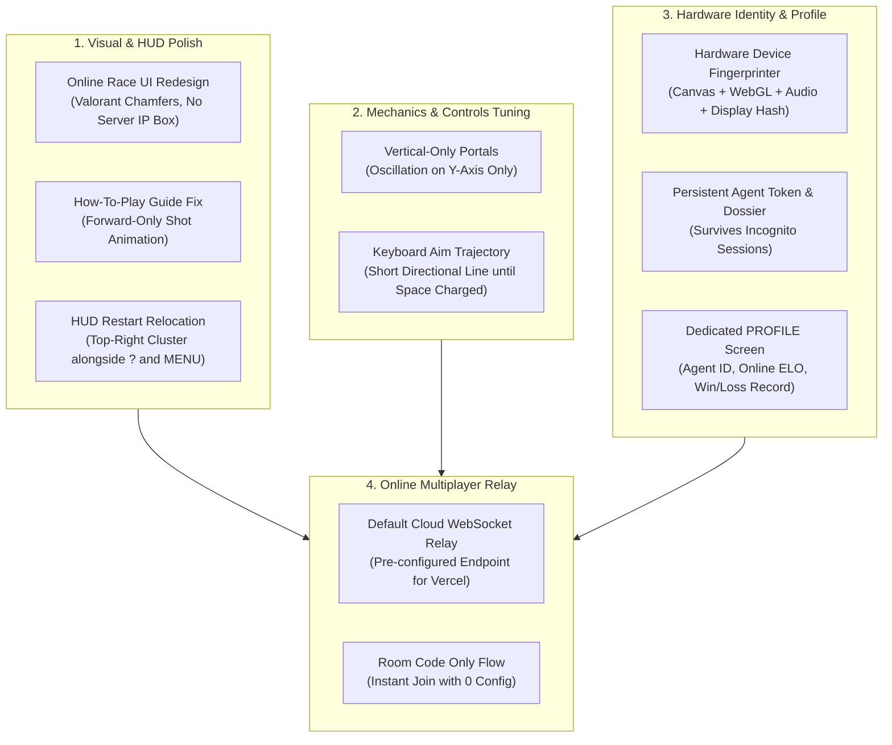

# Master Implementation Plan: Complete UI Polish, Hardware Profile & Competitive Online Mode

This plan details the full implementation for all requirements gathered during our design interview, ensuring high visual consistency, bulletproof offline/online architecture, and competitive integrity.

---

## 1. Architectural Scope & Target Objectives



---

## 2. Detailed Work Breakdown

### Part 1: Online Mode UI Redesign & Vercel Readiness
* **Target Files**: [`src/ui.js`](file:///d:/Game/src/ui.js), [`src/styles/ui.css`](file:///d:/Game/src/styles/ui.css), [`src/network/client.js`](file:///d:/Game/src/network/client.js)
* **Problems Solved**:
  - The current Online Race lobby uses generic HTML input borders and square buttons disconnected from the main game's Valorant aesthetic.
  - Players are currently prompted for a `ws://localhost:8787` server address, which breaks when deployed to Vercel.
* **Implementation**:
  1. **Pre-configured Production Relay**: Set a default production WebSocket relay address (`wss://bankshot-relay.onrender.com` or configurable via window environment variable), falling back to local `window.location.host` or relay. Remove the "SERVER ADDRESS" text input from the UI entirely.
  2. **Valorant Tactical UI Conversion**:
     - Wrap the Online Race screen in the standard `--facet` chamfered slate panel.
     - Redesign the "LEAVE RACE", "CREATE ROOM", "JOIN ROOM", and "READY" controls using `.button-surface`, `--facet`, and high-contrast bone/accent hover states.
     - Add tactical room status pills: `CONNECTING`, `IN LOBBY`, `STARTING IN 3...`, `RACING`.
     - Standardize text inputs with dark `--ink` backgrounds, uppercase tracking, and orange active caret focus borders.

---

### Part 2: Hardware-Bound Persistent Player Profile & Agent Token
* **Target Files**: [`src/state.js`](file:///d:/Game/src/state.js), [`src/ui.js`](file:///d:/Game/src/ui.js), [`src/styles/ui.css`](file:///d:/Game/src/styles/ui.css)
* **Problems Solved**:
  - Currently, player progression and online ratings reset if someone opens an Incognito window or clears browser storage.
  - No dedicated profile screen displays competitive stats bound to the player's physical machine.
* **Implementation**:
  1. **Device Fingerprint Engine (`computeHardwareToken`)**:
     - Computes a deterministic SHA-256 digest from hardware attributes:
       - 2D Canvas rendering quirks (bezier curves, font smoothing rasterization).
       - WebGL unmasked GPU vendor & renderer string (`WEBGL_debug_renderer_info`).
       - Web AudioContext impulse synthesis buffer hash.
       - Display color depth, hardware concurrency (`navigator.hardwareConcurrency`), and pixel ratio.
     - Formats into a tactical Agent Token: `AGENT #XXXX-XXXX` (e.g., `AGENT #7F8A-B4C1`).
  2. **Decoupled Identity Model**:
     - Store player stats, online MMR, win/loss count, best room clears, and career rank indexed against this Hardware Token.
     - Allow custom temporary display names for race lobbies while preserving lifetime stats on the Hardware Token.
  3. **Dedicated "PROFILE" Screen**:
     - Add a "PROFILE" button in the Title Menu.
     - Render an Agent Dossier card showing:
       - Hardware Token badge & Call-sign
       - Online Race Rating (ELO & Tier Badge)
       - Total Races Won / Lost / Win Rate %
       - Campaign Peak Rank & Career Par Percentage
       - Copy Token button to clipboard

---

### Part 3: Fix "How to Play" Screen Ball Animation
* **Target Files**: [`src/ui.js`](file:///d:/Game/src/ui.js), [`src/styles/ui.css`](file:///d:/Game/src/styles/ui.css)
* **Problems Solved**:
  - The SVG guide illustration currently uses `keyPoints="0;1;0"` on `<animateMotion>`, causing the puck to bounce backward along the shot line instead of demonstrating a realistic one-way shot.
* **Implementation**:
  - Update `keyPoints="0; 1"` and `keyTimes="0; 1"` on the motion paths.
  - Implement a clean forward traversal: the puck launches from origin, reflects off walls, enters the goal, fades out, and smoothly loops back to origin for the next shot.

---

### Part 4: Vertical-Only Portal Motion
* **Target Files**: [`src/generator.js`](file:///d:/Game/src/generator.js), [`src/physics.js`](file:///d:/Game/src/physics.js)
* **Problems Solved**:
  - In rooms 31+, portals currently oscillate with horizontal, orbital, or Lissajous patterns (`amplitude: [25, 0]`, `[30, 30]`, `[35, 28]`), occasionally wandering into shot corridors or looking erratic.
* **Implementation**:
  - Restrict portal motion amplitude strictly to the $y$-axis: `amplitude: [0, dy]` (e.g. $[0, 35]$).
  - Force portal motion type to pure linear vertical harmonic oscillation:
    $$y(t) = y_0 + A_y \sin(2\pi f t + \phi)$$
    with zero $x$ displacement ($x(t) \equiv x_0$).
  - Update `src/clearance.js` swept envelope check to reflect pure vertical travel bounds.

---

### Part 5: Keyboard Controls Trajectory Preview
* **Target Files**: [`src/render.js`](file:///d:/Game/src/render.js), [`src/input.js`](file:///d:/Game/src/input.js)
* **Problems Solved**:
  - When rotating with Arrow keys, the renderer currently draws the full multi-bounce aim trajectory across the arena even when not charging a shot.
* **Implementation**:
  - When `input.kind === 'keyboard'` and `!input.charging`:
    - Draw only a short directional pointer ray (e.g. 50px line from the puck indicating current angle).
  - When `input.charging` is active (holding Space):
    - Dynamically scale the trajectory length proportional to the built power ($\text{length} \times \text{power}$), expanding into wall reflections as charge increases toward 100%.

---

### Part 6: HUD Restart Button Relocation & Action Fix
* **Target Files**: [`src/ui.js`](file:///d:/Game/src/ui.js), [`src/styles/ui.css`](file:///d:/Game/src/styles/ui.css), [`src/main.js`](file:///d:/Game/src/main.js)
* **Problems Solved**:
  - The RESTART button currently floats at `bottom: 50px; right: 24px`, overlapping the bottom footer text and looking detached from the rest of the HUD.
  - Mid-shot or paused restart actions can leave state desynchronized.
* **Implementation**:
  - Relocate the `RESTART` button into the top-right `.hud-right` cluster alongside `?` (Guide) and `MENU` (Pause):
    ```html
    <div class="hud-right">
      <button data-action="restart" class="hud-button">RESTART</button>
      <button data-action="guide" class="hud-button">?</button>
      <button data-action="pause" class="hud-button">MENU</button>
    </div>
    ```
  - Remove the floating `.hud-retry` container and bottom styles.
  - In `restart()`, ensure active physics motion, ghosts, and aim states cancel immediately without advancing attempts or triggering double failures.

---

## 3. Verification & Acceptance Criteria

1. **Visual Consistency Check**:
   - Screenshot audit of the Online Race lobby and Profile screens confirming matching Valorant chamfered facets, color tokens, and button surfaces.
2. **Online Relay Auto-Connect**:
   - Create room / Join room connects without any manual server IP input.
3. **Hardware Fingerprint Verification**:
   - Open standard browser window, observe Hardware Token.
   - Open Incognito browser window, verify the Hardware Token matches identically and loads existing stats.
4. **SVG Animation Verification**:
   - Check How-to-Play tab 1 & 2; verify the puck travels forward only into the goal without reverse bouncing.
5. **Portal Vertical Motion Verification**:
   - Run `tests/mechanics.test.mjs` verifying portal $x$-coordinates remain constant while $y$-coordinates oscillate smoothly.
6. **Keyboard Aim Trajectory Verification**:
   - Arrow keys rotate a short directional pointer needle; Space expands the dotted trajectory proportionally to charge.
7. **Complete Test Suite Run**:
   - `npm test`: 100% pass across all 91+ unit tests.
   - `npm run test:browser`, `npm run test:ui-browser`, `npm run test:race-browser`: 100% pass across Playwright tests.
   - `npm run build`: Single-file bundle builds cleanly.
